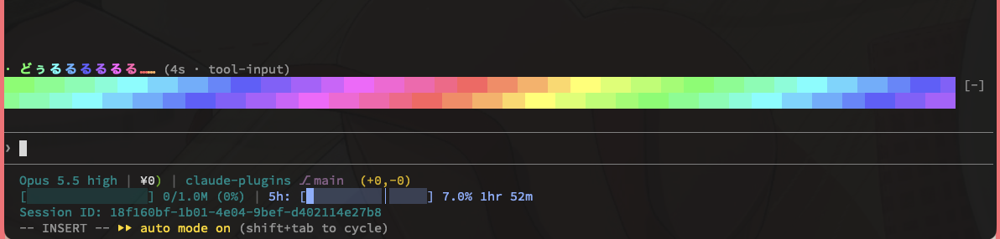

# claude-plugins

ToshihitoKon's Claude Code plugin marketplace.

## Plugins

- [rainbow-working](plugins/rainbow-working/): shows a flowing rainbow band above the prompt and a rainbow spinner word while Claude is working, so you can tell from a distance that a turn is running.

  

## Install

At the prompt of a terminal session:

```
/plugin marketplace add ToshihitoKon/claude-plugins
/plugin install rainbow-working@toshihitokon
```

Or in one line (answer `y` to add the marketplace, then choose a scope):

```
/plugin install rainbow-working --marketplace ToshihitoKon/claude-plugins
```

From a shell:

```
claude plugin install rainbow-working --marketplace ToshihitoKon/claude-plugins
```

In the desktop app, where `/plugin` does not run: click + next to the prompt box, then Plugins, Add marketplace with `ToshihitoKon/claude-plugins`, then Add plugin.

## License

MIT
