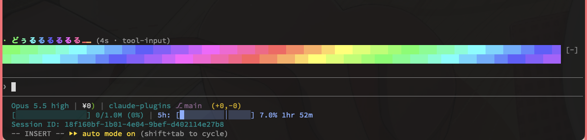

# rainbow-working

A Claude Code mod that makes it obvious from across the room that Claude is working.



While a turn is running in the terminal:

- a two-row rainbow band flows above the prompt input, drawn with `▓` in two tones of the same color (foreground and a darker background)
- the spinner line is redrawn with its word in rainbow colors, followed by the elapsed time and the current mode (`thinking`, `tool-use`, ...)

The rainbow is built in the OKLCH color space, so its colors look evenly bright, and the hues are spaced by named colors (red, orange, yellow, green, cyan, sky blue, blue, indigo, magenta) rather than by equal angles, which gives blue a wider share of the band.

When Claude is back at the prompt but background agents (subagents, teammates) are still running, the band keeps flowing as a lighter `░` pattern with no background color, so it looks darker. Every 15 seconds the mod checks the session's agent list; if none of them is running, it clears the band, so it stops within 15 seconds even if it missed an agent's end. Workflow agents are not in that list, so the `░` band for a Workflow running alone in the background stops within 15 seconds and comes back when its next agent starts.

When Claude is waiting for your input and no agent is running, nothing extra is drawn and the animation timers are stopped.

The band and spinner are redrawn every 200 ms, about half of the engine's redraw limit, so the colors flow slowly and the rainbow takes about six seconds to cycle once.

Note: because the spinner line is drawn by the mod, the token count and effort level that Claude Code normally shows there are not displayed.

## Install

```
/plugin install rainbow-working --marketplace ToshihitoKon/claude-plugins
```

Answer `y` to add the marketplace, then choose a scope (user scope loads it in every session).
